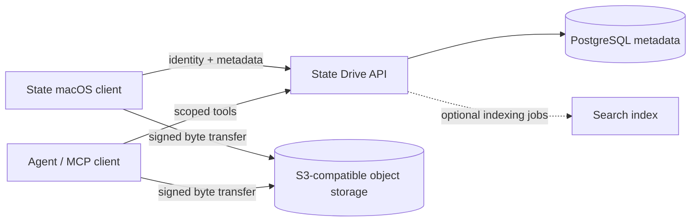

# State architecture and implementation plan

## Product direction

State should keep the native macOS Finder experience and adopt the useful shared-drive behaviors seen in FlashDrive: one canonical workspace view, agent access through a scoped interface, revision history, safe trash, and fast file search. State should keep its own provider flexibility and support self-hosting.

## Current state

The macOS client is a direct-to-object-store application. It has a SwiftUI menu-bar app, an FSKit extension, a sparse-image fallback, an S3-compatible client, local cache and offline pins, and provider setup for B2, S3, R2, Wasabi, and MinIO. Its current workspace and invite UI are local preferences. It does not yet use the State Drive API for its file listing, writes, identity, membership, or agent access.

A first private-drive API foundation exists in the hosted API. It covers per-user file metadata, folder creation, signed upload/download URLs, revisions, quota checks, and trash/restore. The Mac client has not been connected to it, and the API is not yet packaged as a standalone self-hosted service.

## Target architecture

The API owns the canonical workspace, object revisions, ACLs, quota, trash, and agent grants. File bytes move directly between clients and the configured object store using short-lived signed requests. For deployments that use local object-store credentials, retain a single-user direct mode as an explicit option.

## Recommended implementation sequence

### 1. Stabilize the service contract

Document the workspace, file, revision, upload-session, and error models. Add workspace memberships, invitations, file move/rename, multipart uploads for large files, and revision restore. Enforce authorization and revision checks at the service boundary.

### 2. Connect the Mac app

Add sign-in and a session token stored in Keychain. Put API access behind a client protocol so direct-provider mode remains separate. Replace local workspace identity with server state. Keep FSKit byte-range reads, request object metadata before reads, and key bounded cache entries by immutable revision. Use staged uploads and compare-and-swap on writes; surface a conflict copy when another writer advances the revision.

### 3. Add agent access

Expose a remote MCP service using the same workspace and authorization rules. Begin with list, read, search, create, write, and trash/restore tools. Let users issue and revoke scoped agent grants; never give agents bucket credentials.

### 4. Add efficient search and collaboration

Implement exact filename/path search and metadata filters before optional content indexing. Add indexing only when a workspace opts in. Share a single revision and activity model between the Mac client and agent tools.

### 5. Make self-hosting repeatable

Extract the API feature into a standalone deployment package with migrations, environment examples, local development setup, backup guidance, and upgrade instructions. Support PostgreSQL and S3-compatible storage first. Keep hosted State and self-hosted installations on the same API contract.

## Cost and performance guardrails

- Keep file bytes out of the API process; use short-lived signed storage URLs.
- Do not add a worker or always-on indexer until a feature needs one.
- Paginate metadata queries and avoid listing an entire bucket for routine Finder navigation.
- Keep cache limits configurable and avoid downloading whole files for the normal online mount path.
- Make content indexing opt-in and asynchronous, with explicit per-workspace limits and retention.
- Track storage bytes, API request volume, and indexing work separately so quotas and spending limits are visible.

## Open-source boundary

This repository contains the macOS client. The hosted API foundation currently lives in a separate private application and has not yet been extracted into a self-hostable State service. Publishing the client does not make the current hosted service or all FlashDrive-like collaboration features available. The architecture above describes the remaining work without exposing deployment credentials or private infrastructure identifiers.
